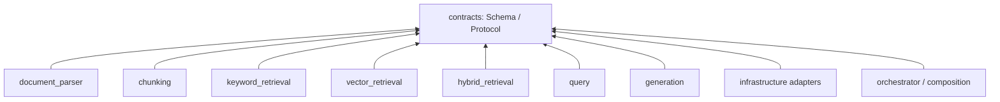

# 总体架构

本项目是单 Python 包、单部署单元的模块化单体。模块边界是代码与数据契约边界，不是网络边界。

七个业务模块分别负责：Document 建模、Chunk 描述、关键词索引/检索、向量索引/检索、显式融合、查询规划/执行、证据约束生成。file_store、evaluation、observability、config 是横向能力；orchestrator 是唯一跨阶段业务编排者。

离线数据流：`PDF FileRef → Parser → Document → Chunking → ChunkBatch → Keyword/Vector index`。其中 Parser 与 Chunking 已实现为可独立注入的进程内能力；检索索引仍属后续任务。Parser 不调用 Chunking，Chunking 不写索引。

在线数据流（未来实现）：`Question → Query.plan/execute → Hybrid(Keyword + Vector) → Evidence → Generation → AnswerResult`。Generation 只看到证据，不执行检索。Task 0 仅定义上述边界，不执行数据流。

