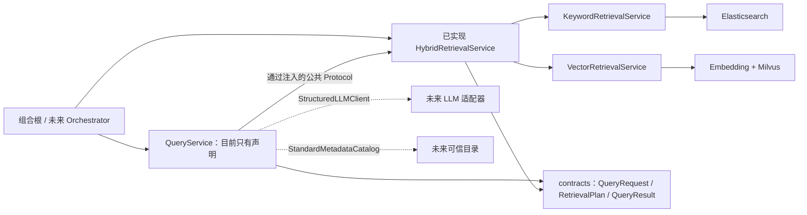
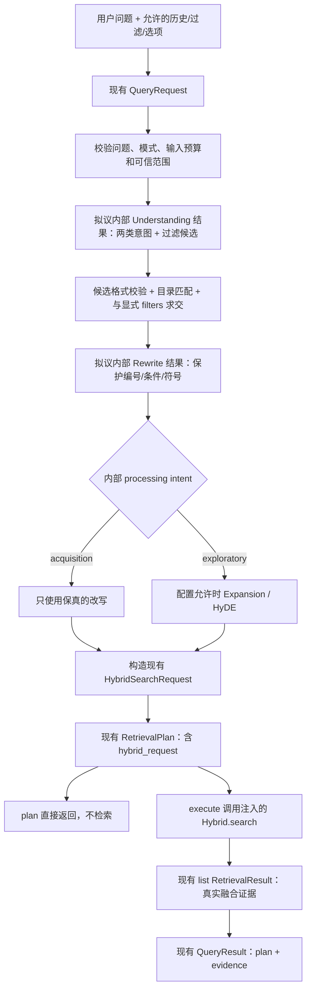

# Task 6.0：Query 数据流与架构设计

日期：2026-10-18。**本文是建议方案，Query 业务链尚未实现。** 实际接口证据与缺口编号见
[接口审查](query-task6-interface-audit.md)。Task 6.0.1 已按
[ADR-Q-001](adr-task6-query-prerequisites.md) 落地 Query 2.0 和 LLM/目录依赖契约；
Document V2.4 与检索契约保持原样。下文业务流依然属于后续实现设计。

## 1. 调用边界

组合根创建 Keyword、Vector、Hybrid 后，仅将公共 `HybridRetrievalService` 注入 Query。
Query 内不得导入三个模块的具体实现或 internal，不持有 Elasticsearch/Milvus 客户端。
共享 LLM 与目录边界已有公共 Protocol，真实适配器仍未实现；由组合根提供实例。



未来 Orchestrator 负责 Query 与 Generation 跨阶段组合；Query 可以直接调用 Hybrid.search，
不需要让 Orchestrator 拆解 Query 内的规划步骤。Generation 接收真实 evidence，不参与规划。
这保持单向依赖，无需新增 HTTP 层或形成循环导入。

## 2. 类型化数据流



图中两类 processing intent 写入独立 `RetrievalPlan.processing_intent`，不写入语义 intent；
计划及 QueryResult 已局部升为 2.0，C1 的契约门槛已解决。
图描述目标链，不代表现有 QueryService 可以运行。

### plan 与 execute

`plan(request)` 只生成 `RetrievalPlan`，不检索；建议允许模型调用，因此“无检索副作用”
不等于“无网络或模型费用”。它必须记录模型/配置/提示版本，模型随机性不承诺逐字一致。
`execute(request)` 内部规划一次，再以该计划调用一次 Hybrid.search，并把同一个计划返回。
当前 Protocol 没有 `execute(plan)`；外部先 plan 再 execute(request) 可能重新生成计划，
不要宣称第二次必定执行首次 plan。如需直接执行已批准计划，应另行评审 API。

首版已采纳仅支持 `options.mode=hybrid`；keyword/vector 是合法 DTO 值但尚无可执行单路计划
结构。调用它们应抛明确 unsupported 错误，不能默默改 mode 或用空分支冒充 Hybrid。

### 输入输出映射

| 输入/内部结果 | 现有输出字段 | 设计规则 |
| --- | --- | --- |
| QueryRequest.question | plan.original_question | 原样保留；非空白与长度额外校验 |
| history | 内部理解/改写上下文 | 有界、保留 role；历史不成为检索证据，不覆盖当前显式范围 |
| 主改写、去重扩展 | plan.rewritten_queries | 建议第 1 条为主改写，随后为扩展；阶段角色/来源另存内部诊断 |
| HyDE | plan.hypothetical_document | 明确假设文本；禁入 evidence，不被 Generation 当引用 |
| acquisition/exploratory | plan.processing_intent（必填） | 两类处理意图；原语义 intent 五类不变 |
| 已验证 filters | plan.hybrid_request.keyword.filters 与 vector.filters | 两份深复制保持同一用户范围 |
| options.top_k | plan.hybrid_request.top_k | 来自用户，超过部署上限报错，不静默缩小 |
| 注入的规划配置 | candidate_k、fusion_strategy、两路 index_name、权重 | 所有字段来自可信配置，不接受 LLM 生成后端路由 |
| Hybrid.search 返回值 | QueryResult.evidence | 保留完整公共结果与顺序，不再包装另一个 RetrievalResult |
| trace、诊断、LLM 用量 | 当前无 plan/result 专用字段 | 通过注入 Observability 和私有运行记录关联；需要对外状态时处理 C3 |

## 3. 两路文本与检索参数

获取性：关键词侧用主改写、精确术语和显式编号；向量侧使用同一保真主改写。
探索性：关键词侧可增加少量经过保真检查的同义词；向量侧用主改写、去重扩展和可选 HyDE。
HyDE 与原问题发生编号、数值、单位或否定条件冲突时丢弃该增强，不据此修改过滤条件。

现有接口每路只有一个 query 字符串，首版建议将少量表达按固定顺序合成为一个有界文本，
保持主问题与保护条件优先；不是多查询各自召回、也没有新增多轮融合。更复杂 fan-out 留待独立任务。
应在 6.3 比较“主问题”“主问题+扩展”“主问题+HyDE”，而不是默认无限拼接所有内容。
实际 tokenizer 和截断由 Vector 模型决定；需明确预算、防止增强挤掉主问题，不能声称任意长文本
都会完整进入向量。Query 不自行加载 Vector tokenizer 私有实现。

Vector 会继续在 `embed_query` 前添加其配置的 query_instruction，Query 不重复添加。
这个固定 Embedding 前缀不生成任何假设文档；HyDE 是 Query 侧未来单独的 LLM 输出。

以下仅验证**现有 DTO 可表达两个不同文本**，全部规范名称为虚构演示；不实现 Query 算法：

```python
from engineering_rag.contracts.queries import RetrievalPlan
from engineering_rag.contracts.retrieval import (
    HybridSearchRequest,
    KeywordSearchRequest,
    SearchFilters,
    VectorSearchRequest,
)

filters = SearchFilters(standard_codes=["GB/T 00000-2026"])
hybrid_request = HybridSearchRequest(
    keyword=KeywordSearchRequest(
        query="设备基础 检修空间",
        filters=filters.model_copy(deep=True),
        top_k=50,
        index_name="demo_keyword",
    ),
    vector=VectorSearchRequest(
        query="设备基础周围的检修与维护操作空间要求",
        filters=filters.model_copy(deep=True),
        top_k=50,
        index_name="demo_vector",
    ),
    fusion_strategy="rrf",
    candidate_k=50,
    top_k=10,
)
plan = RetrievalPlan(
    original_question="设备基础需要多少检修空间？",
    rewritten_queries=["设备基础周围的检修空间要求"],
    processing_intent="acquisition",
    retrieval_mode="hybrid",
    hybrid_request=hybrid_request,
)
assert plan.hybrid_request.keyword.query != plan.hybrid_request.vector.query
assert RetrievalPlan.model_validate_json(plan.model_dump_json()) == plan
```

此例显式提供处理意图，语义 intent 仍合法使用默认 unknown；它只是 DTO 能力演示，不包含意图算法。
示例标准代码假设已由可信测试目录确认，真实运行不能照搬为过滤条件。

默认建议采用 RRF，显式写 `fusion_strategy="rrf"`（当前模型字段无默认值），两权重 0.5/0.5。
需要 0.6/0.4 时用合法 `weighted_normalized`。规划配置给出两索引名与候选上限；首版每路共享
candidate_k=50，最终 top_k 默认 10。不能靠子请求 top_k 实现不同候选数，Hybrid 会覆盖它们。
两后端候选上限及实际 HNSW 参数应由组合根确认，再校验请求预算，不改 Vector/Keyword。

## 4. 过滤条件：候选 → 验证 → 应用

1. 接受用户显式 filters 和本轮问题；LLM 只输出候选值、原文范围和歧义信息，不能输出数据库表达式。
2. 内部 Pydantic 模型拒绝未知字段、非法枚举、超长值，校验候选是否在问题中有依据。
3. 用注入的可信目录快照核验 document、标准代码/名称、版次及必要的条文存在性。
   记录目录版本与索引可见范围；全局标准有效不等于已入当前知识库。
4. 与显式 filters 合并时只允许收窄，不可被 LLM 扩大。同字段集合求交，不同字段维持 AND。
   空交集必须报 scope conflict；绝不能用空数组表示空交集，后端把空数组解释为不限制。
5. 验证成功后创建新的 SearchFilters，并深复制到两路。保留原用户输入和候选审查记录。

用户明确指定标准而目录找不到、名称多义或版次不明时，建议中止并返回内部
`unmatched_scope/ambiguous_scope` 类型错误供上层澄清，不自动扩大到全库。
当前 QueryResult 无澄清状态，先走明确异常；若需结构化交互结果另行批准 C3。
对于非显式、低可信推断候选，建议忽略其精确过滤、保留原问题检索，并记录未采用原因。
没有目录时不可声称存在性验证通过；测试可用人工可信快照，正式运行显式范围无法验证则中止。

标准名没有 SearchFilters 字段，可经目录解析成 document_ids。条文号应结合文档和正文/说明范围，
不跨版本猜测唯一条文。`is_mandatory=True` 仅表达“检索已有强条标记”的意图；不产生强条事实。
`is_mandatory=None` 是不筛选，无法表达只筛选未知状态。修订版、章节和物理页范围没有过滤字段，
不得塞入 field_weights 或自由字段。可信上层范围如已验证，可使用其带版本证明；不能默认所有
类型正确的 QueryRequest.filters 已做存在性校验。

## 5. LLM 依赖与有界执行建议

Task 6.0.1 已提供 StructuredLLMClient.generate 及 Request/Response/Config/Usage DTO。
Request 约束 stage、input、output_schema、模型配置、超时、token 预算和 trace；Response
data 必须经过 validate_output(request, OutputModel) 才能成为业务 DTO，之后还需范围/事实验证。
模型适配器与可运行 Prompt 尚未实现。GenerationService 不承担该职责，Query 不调用它生成“答案”。

StandardMetadataCatalog.lookup 已有四态结果、目录快照、知识库双索引范围与 is_test_fixture；
调用方须 validate_for(request)。契约本次不提供条文存在性验证，相关需求必须另取证据能力，
不能根据标准匹配就宣称条文已验证。实际生产目录尚未建设。

| 阶段 | 建议调用次数 | 失败策略 |
| --- | --- | --- |
| Understanding + 过滤候选 | 合并一次结构化调用 | 输出校验失败可在总预算内纠正一次；仍失败中止，避免把未知意图当 acquisition |
| Rewrite | 单独一次，便于保真独立验收 | 非法输出或保护项改变则使用原问题，记录 degraded；不能丢掉已验证显式范围 |
| Expansion | 仅 exploratory 且开关启用，一次 | 失败使用主改写；限制数量、去重和总长度 |
| HyDE | 仅 exploratory 且开关启用，一次 | 失败不使用 HyDE，继续主改写/合法扩展；不生成伪证据 |
| Hybrid.search | 有计划后一次 | 后端错误原样传播，不因模型回退政策变成单路结果 |

候选参数建议：扩展最多 3 条、每阶段最多 1 次重试；6.1 落地时再据所选模型确定 token/
超时数值并写配置。临时连接故障/超时可在全局截止时间内有限退避；认证、模型不支持、
输入超限不重试。结构化修复与传输重试共用该阶段总尝试预算，不能分别叠加形成无界循环。
获取性只运行理解和改写。探索性最多再执行两次增强，无 Agent 自主循环。

所有 LLM 输出先内部 Schema 校验，再做范围/保真验证；对历史和候选文本仅按数据处理。
日志默认不写问题全文、历史、HyDE 或凭据，记录 trace_id/task_id、阶段、模型/提示/配置版本、
耗时、重试数、token 用量/未知、状态与回退原因。如需受控文本审计，另存权限受控 sidecar，
不塞入 QueryResult.evidence。plan/result 已可包含问题与 HyDE，持久化它们应遵守调用方数据政策。

## 6. 返回、错误与验收边界

成功时返回 `QueryResult(plan=实际使用的计划, evidence=Hybrid 返回结果)`；不更改内容、页码、
标准版次、chunk_id、rank、score_type。仅真实检索返回对象可进入 evidence。
上层随后可用 GenerationRequest(question=原问题, evidence=result.evidence, history=原历史)
组装答案请求；这由未来 Orchestrator 完成，本阶段没有实现。

`evidence=[]` 只表示检索正常无命中。过滤未匹配、模型关键阶段失败、配置错误、后端超时与
正常空结果必须区分。公共结果不能完整承载警告/澄清/trace，这是 C3；精确 Block/bbox 引用是
检索层 C4。仅有文档、条文和物理页级来源时不得伪造更细引用。

下一阶段首先用注入替身证明 plan 不检索、execute 只调用一次、不同两路文本和相同可信范围
确实到达 Hybrid。模型真实性和检索收益在 6.5 单独验收，不用结构化 DTO 校验冒充业务质量。
